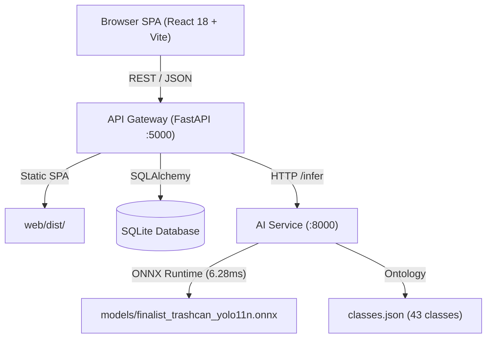

# Vision-Studio Final

> Precision-instrument oceanographic intelligence platform serving real trained YOLO11 detectors for underwater debris, benthic survey mapping, and acoustic anomaly classification.

`#underwater-ai` `#yolo11` `#oceanography` `#marine-debris` `#sonar-telemetry` `#edge-inference` `#computer-vision` `#precision-instruments`

---

## Visual Overview

| Overview Dashboard (1440px Dark) | Analysis Viewer & Graticule (1440px Dark) |
|---|---|
|  |  |

| Bathymetric Survey Chart | Model Lab & Training Curves |
|---|---|
|  |  |

---

## Key Features

1. **Real Trained Detectors**: Serves real YOLO11n weights trained from COCO on leakage-free grouped partitions of TrashCan 1.0 (22 classes) and DeepPlastic (1 class) without video temporal leakage.
2. **Deterministic ONNX Serving**: Deployed with ONNX Runtime on CPU delivering 6.28 ms inference latency with zero PyTorch cold-start penalty.
3. **Survey Chart Meets Instrument Panel**: Strictly tokenized deep-ocean design system:
   - Palette: Abyss (`#0A2433`), Tide (`#0E6F7C`), Shallows (`#BFE3E6`), Fog (`#EEF3F4`), Signal (`#FF5A1F`).
   - Distinctive tabular typography, depth ramps, hairline borders, and colorblind-safe chips.
4. **Signature Analysis Viewer**: Smooth pan/zoom, graticule grid, minimap, non-overlapping leader-line labels, live confidence slider, dual-model swipe compare, and telemetry readout.
5. **Multi-Viewport & Responsive**: Engineered for mobile (375px bottom bar with 44px touch targets), tablet (768px), and workstation (1440px) displays in both Dark and Light themes.
6. **Explain Mode & Pipeline Inspector**: Live trace waterfalls showing execution stage durations from `GET /api/analyses/{id}/trace`.

---

## Architectural Topology



---

## Quickstart

### 1. Launch with Python Only (Zero Node Required)
Pre-built production assets are bundled in `web/dist`. Simply run:

```bash
# Start backend and serve UI
python run.py

# Or start with ~400 synthetic demonstration analyses populated:
python run.py --demo
```
The browser will automatically open at `http://localhost:5000`.

### 2. Development Setup (With Node Hot-Reload)
```bash
# Terminal 1: Run dev mode (spawns FastAPI + Vite dev server)
python run.py dev
```

---

## Model Retraining & Reproduction

To reproduce dataset partitioning, run sweeps, or train full-scale weights on cloud GPUs, follow [REPRODUCE.md](REPRODUCE.md).

For cloud GPU retraining notebooks and scripts, see [gpu_kit/](gpu_kit/).

---

## Verification & Testing

```bash
# Run backend AI-service tests
pytest ai-service/tests

# Run API Gateway tests
pytest api/tests

# Run web frontend unit tests
cd web && npm test
```

---

## Licensing & Attribution

- Application code: MIT License.
- Model architecture: Ultralytics YOLO11 (AGPL-3.0).
- Datasets: TrashCan 1.0 (CC BY-NC-SA 4.0), DeepPlastic (Academic).
- Full legal attribution and third-party notices are detailed in [NOTICE.md](NOTICE.md).
